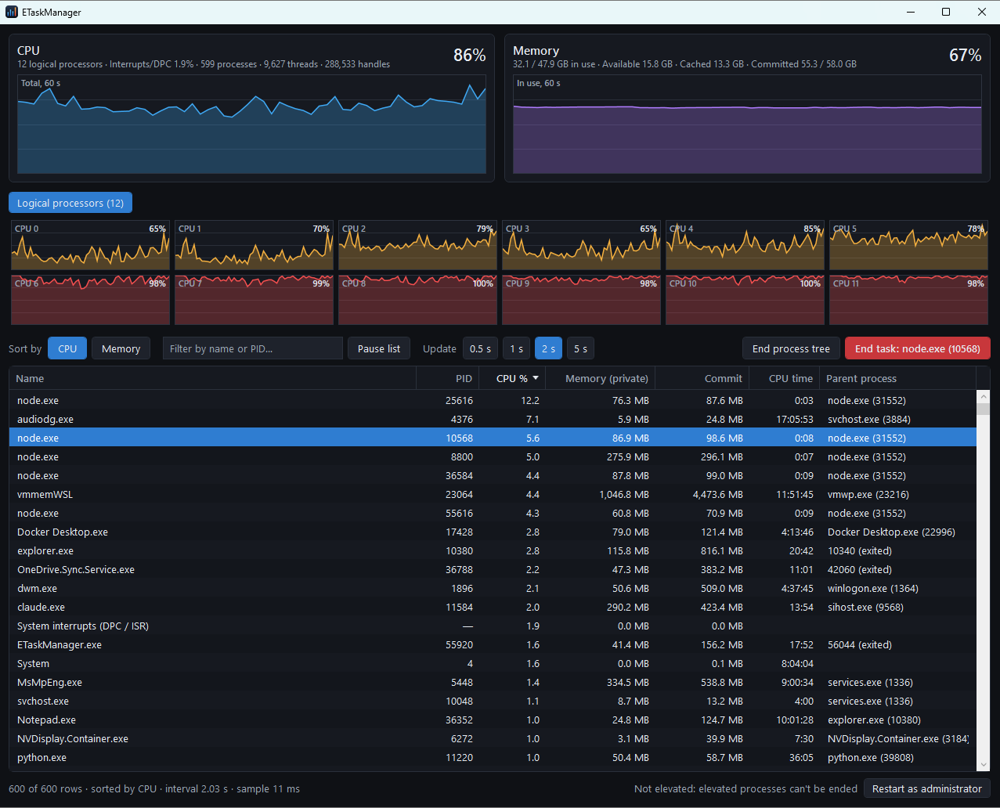

# ETaskManager

**A reliable task manager with MCP support.**

A small, reliable replacement for the Windows 11 Task Manager's *Performance* and *Processes* views,
built to stay accurate and responsive even when every core is at 100%. While it runs, it also serves an
[MCP](https://modelcontextprotocol.io) server, so coding agents like Claude Code can ask what is eating the machine's CPU and memory.

**[⬇ Download ETaskManager.exe](https://github.com/kkilictepe/ETaskManager/releases/latest)**: a single exe, no install or .NET needed (Windows 10/11 x64).
Windows SmartScreen may warn because the exe isn't code-signed; click **More info → Run anyway**.



- CPU graph for the whole system and for **every logical processor** (60 s history, turns amber/red under load)
- Memory: in use / available / cached / committed, with history graph
- All processes, sortable by **CPU** or **Memory** (or any column), with a name/PID filter (Ctrl+F)
- **End task** / **End process tree** (button, Del / Shift+Del, or right-click) with a confirmation that shows the process **name and PID**
- **MCP server for coding agents**: read-only live CPU / memory / process data at `http://localhost:7457/mcp`

## Build & run

Requires the .NET 9 SDK (x64 Windows).

```powershell
dotnet build -c Release
.\ETaskManager\bin\x64\Release\net9.0-windows\ETaskManager.exe
```

Single self-contained exe (no .NET install needed on the target machine):

```powershell
dotnet publish ETaskManager -c Release -r win-x64 --self-contained -p:PublishSingleFile=true -o publish
.\publish\ETaskManager.exe
```

Run as administrator (or use the **Restart as administrator** button) to end processes owned by
SYSTEM or other users. Protected processes (e.g. Defender) can't be ended even by an administrator.

## MCP server for coding agents

While ETaskManager is open it serves a [Model Context Protocol](https://modelcontextprotocol.io) server
(Streamable HTTP) at `http://localhost:7457/mcp`, so an agent can see what is slowing the machine down,
for example a runaway build, a leaked `node.exe` dev server or a browser tab eating memory.

Connect Claude Code (the **MCP** button in the status bar copies this command):

```powershell
claude mcp add --transport http etaskmanager http://localhost:7457/mcp
```

Other MCP clients: add an HTTP server with that URL.

| Tool | What it returns |
|---|---|
| `get_system_overview` | Total and per-core CPU, interrupt/DPC time, memory and commit, process/thread/handle counts, top processes by CPU and by memory |
| `get_top_processes` | Processes sorted by `cpu`, `memory` or `commit`; CPU averaged over a recent window (`window_seconds`, default 10); `group_by_name` sums e.g. all `chrome.exe`; `name_filter` by name or PID |
| `get_process_details` | One PID: CPU latest/average/peak, memory, threads, handles, start time, **executable path and command line**, parent chain, children and whole-tree totals |

- The data comes from the same sampler as the UI (up to 300 recent samples are kept for averaging), on its own thread,
  so it keeps answering at 100% CPU and while the list is paused.
- CPU % is the share of the whole machine (all logical processors = 100%), same as the UI.
- **Read-only**: agents can't end processes. Only `localhost` is bound, and requests from non-local browser origins are rejected.
  There is no authentication, so any program on this PC can read the data, including process command lines (which can
  contain tokens). When ETaskManager runs as administrator, that includes command lines of elevated processes. Set
  `ETM_MCP=0` if that matters on your machine.
- Path and command line of elevated processes need ETaskManager to run as administrator.
- Settings (environment variables): `ETM_MCP_PORT=<port>` changes the port, `ETM_MCP=0` turns the server off.
  If the port is taken (e.g. a second ETaskManager), the button shows **MCP: unavailable**.

## Why the numbers are correct

- One `NtQuerySystemInformation(SystemProcessInformation)` call per tick gives every process's CPU time
  at the same instant; per-process % = Δ(kernel+user) ÷ the total CPU time that elapsed across all cores.
  The divisor is measured by the kernel, not assumed, so late ticks under load don't distort values and
  the per-process values add up to the total (± clock-tick granularity).
- This is **time-based CPU %** (like `\Processor\% Processor Time`), not Task Manager's frequency-scaled
  "Processor Utility", which is why Task Manager's per-process column and total often disagree.
- Processes are tracked by PID **and** start time, so PID reuse never produces bogus values, and
  *End task* re-verifies the start time before terminating, so it can't hit a different process.
- Interrupt/DPC time isn't charged to any process, so it's shown as its own row.

## Why it doesn't lock up at 100% CPU

- The app runs at **High** priority (like Task Manager / Process Explorer); sampling happens on a dedicated
  highest-priority thread, never the thread pool.
- Snapshots are handed to the UI "latest wins" at Background dispatcher priority, so input is always processed first.
- The process grid is a fixed set of row slots whose values are updated in place: no collection resets,
  no re-layout of the whole grid. Typical cost: ~12 ms sampling + ~15 ms UI per second
  (≈5% of one core with ~750 processes).

## Diagnostics

Set `ETM_DIAG=<path to log file>` before starting to log per-tick timings and the
"total vs. sum of processes" CPU check.

## Icon

`ETaskManager/Assets/app.ico` (16–256 px, each size drawn separately so small sizes stay crisp) and
`logo.png` are generated by `python tools/make_icon.py ETaskManager/Assets preview.png` (needs Pillow).

## Limitations

- Per-core data covers the current processor group (machines with ≤ 64 logical processors).

## License

[MIT](LICENSE): free to use, modify and redistribute.
